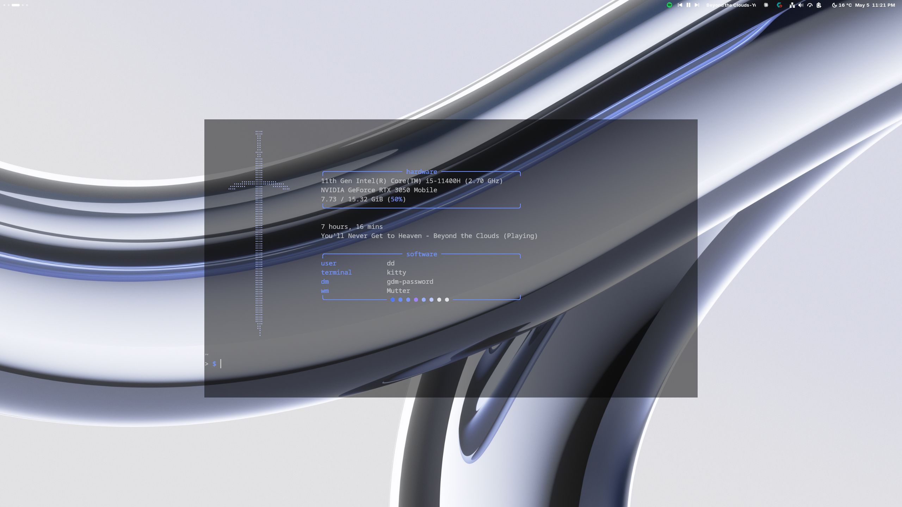

# dotfiles

CachyOS dotfiles for GNOME, Kitty, and Fish, with package lists and backup scripts. Archived.



## Use

```sh
git clone https://github.com/drugdamage/dotfiles.git ~/dotfiles
cd ~/dotfiles
```

- `./backup.sh` saves the current settings and package lists to this folder.
- `./restore.sh` installs packages and restores shell, terminal, wallpaper, and GNOME settings on CachyOS.

Run as your normal user; restore uses `sudo` when needed. It overwrites matching settings, so back up your current configuration first. Reboot after restoring.
